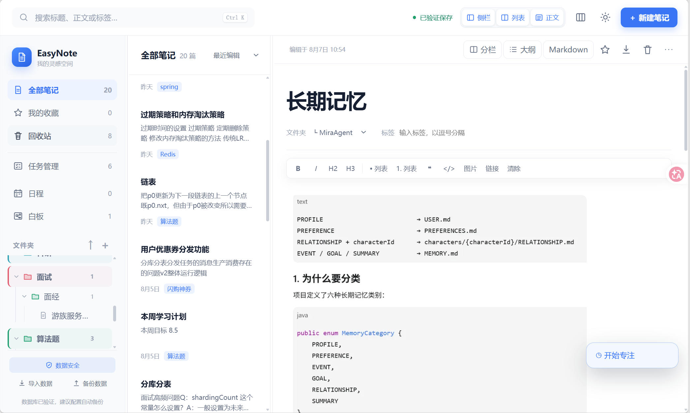
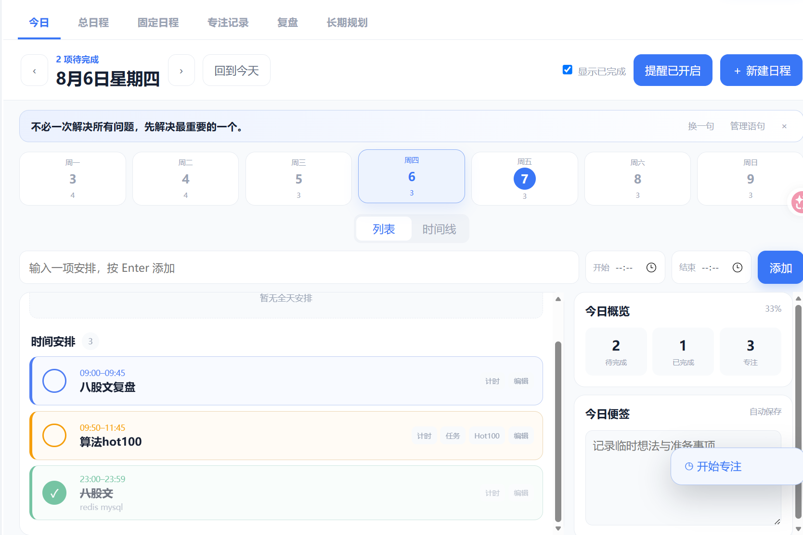
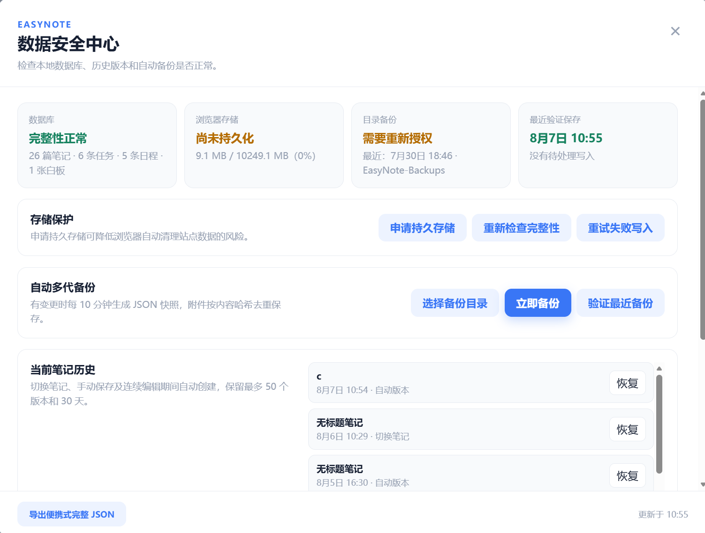
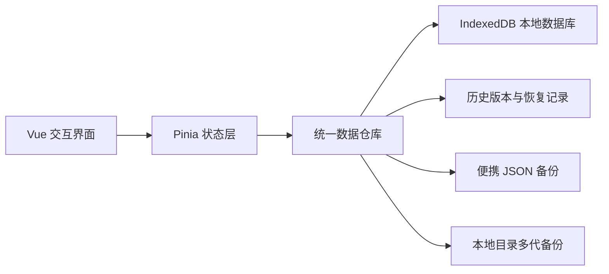

<div align="center">
  
  <h1>EasyNote</h1>
  <p><strong>本地优先的一体化个人知识与效率工作台</strong></p>
  <p>把笔记、任务、日程、专注、复盘、长期规划与知识白板，放进一个真正由用户掌控的数据空间。</p>

  <p>
    
    
    
    
  </p>

  <p>
    <a href="#界面展示">界面展示</a> ·
    <a href="#项目亮点">项目亮点</a> ·
    <a href="#技术实现">技术实现</a> ·
    <a href="#快速开始">快速开始</a>
  </p>
</div>

---

## 项目简介

EasyNote 是一款基于 Vue 3、TypeScript 与 PWA 技术打造的本地优先个人知识与效率管理工具。它将笔记、任务、日程、专注计时、复盘、长期规划和知识白板整合在同一个简洁流畅的工作空间中，无需后端服务即可运行，并支持桌面端与移动端访问。

所有数据默认保存在本地，配合写入校验、历史版本、紧急恢复、JSON 导入导出及自动备份机制，在保护隐私的同时降低数据丢失风险。无论是记录知识、安排学习计划，还是管理长期目标，EasyNote 都致力于提供一个轻量、可靠、离线可用且真正由用户掌控的数据空间。

## 界面展示

### 沉浸式笔记工作区

三栏布局集中呈现文件夹、笔记列表与正文，支持富文本和 Markdown、大纲、标签、双笔记分栏、图片排版与专注模式。



<table>
  <tr>
    <td width="50%" valign="top">
      
      <br><strong>时间与规划中心</strong>
      <br><sub>日程、专注、复盘与长期目标形成完整执行闭环。</sub>
    </td>
    <td width="50%" valign="top">
      
      <br><strong>数据安全中心</strong>
      <br><sub>集中查看数据库完整性、持久存储、备份与恢复状态。</sub>
    </td>
  </tr>
</table>

## 项目亮点

| 能力 | 设计重点 |
| --- | --- |
| **本地优先** | 无需账号和后端，核心数据保存在浏览器 IndexedDB 中，离线也能继续工作 |
| **一体化工作流** | 笔记、任务、日程、专注与目标彼此关联，减少在多个工具之间来回切换 |
| **可靠的数据保护** | 串行写入、回读校验、历史版本、紧急恢复、便携 JSON 与目录多代备份 |
| **跨设备形态** | 同一套 Web 应用适配桌面与移动浏览器，并可作为 PWA 安装使用 |
| **丰富的交互体验** | 拖拽、右键菜单、快捷键、分栏、时间线、看板和无限画布覆盖高频操作 |
| **可验证的工程质量** | 使用 TypeScript、Vitest 与 Playwright，覆盖数据升级、核心流程和视觉回归 |

## 核心功能

### 笔记与知识管理

- 支持搜索、标签、收藏、回收站以及无限层级文件夹。
- 提供富文本与 Markdown 两种编辑方式，并根据 H1/H2/H3 自动生成大纲。
- 支持双笔记分栏、图片粘贴与拖拽、多图排版、本地文件附件和单篇 Markdown 导入导出。
- 提供笔记历史版本与永久删除后的紧急恢复能力。

### 任务与项目推进

- 在表格和看板之间同步管理任务，支持分组、筛选、多条件排序与跨列拖拽。
- 内置文本、单选、多选、数字/进度、日期、复选框、链接、附件和关联笔记等自定义字段。
- 任务可直接安排进日程、关联笔记，或启动专注计时。

### 时间与长期规划

- 今日工作台提供七日导航、列表视图、30 分钟时间线与全天安排。
- 固定日程支持每天、工作日、每周和每月重复，并可关联任务、笔记与网址。
- 专注计时支持暂停、刷新续算、休息阶段、桌面悬浮和历史记录。
- 每日、每周、每月复盘保存统计快照；长期规划使用“目标 → 里程碑 → 关联任务”推进。

### 白板与知识连接

- 在无限画布中组织文本、笔记、任务、图片、网页与分组卡片。
- 支持缩放、平移、网格吸附、多选、换色、层级调整、撤销重做和带方向连线。
- 笔记与任务卡片实时读取源内容，白板数据同样进入备份与恢复体系。

## 数据安全设计

EasyNote 不把“点击保存”直接等同于“保存成功”。只有数据写入并回读校验通过后，界面才会显示“已验证保存”。



- 数据库升级前先建立完整恢复记录，无法建立时停止升级。
- 笔记、任务、日程、白板、附件和规划数据进入统一校验与备份流程。
- 提供持久存储状态、容量使用、最近验证保存和最近目录备份检查。
- 单个本地文件上限为 25 MB；自动目录备份目前不加密，应选择受系统账户保护的可靠磁盘。

## 技术实现

| 层级 | 技术 |
| --- | --- |
| 前端框架 | Vue 3、Composition API、Pinia、Vue Router |
| 工程化 | TypeScript、Vite、Vue TSC |
| 离线能力 | PWA、Service Worker、Web App Manifest |
| 本地数据 | IndexedDB、File System Access API、JSON Backup |
| 自动化测试 | Vitest、Vue Test Utils、Playwright |
| 兼容形态 | Windows 桌面启动器、现代桌面/移动浏览器 |

## 快速开始

需要 Node.js 20 或更高版本：

```powershell
git clone https://github.com/xfkl210135/easynote.git
cd easynote
npm install
npm run dev
```

开发服务器默认运行在 `http://localhost:4173/`。

Windows 用户也可以双击 `start-easynote.bat` 启动固定地址的本地服务，或运行 `create-desktop-shortcut.bat` 创建桌面快捷方式。固定来源可以确保浏览器继续访问同一份 IndexedDB 数据。

## 构建与测试

```powershell
npm run build
npm test
npm run test:e2e
```

- `npm run build`：执行 TypeScript 类型检查并生成 `dist/` 生产文件。
- `npm test`：运行数据仓库、数据库升级与时间规划相关单元测试。
- `npm run test:e2e`：在桌面与移动端视口下验证核心流程、离线能力和视觉基线。

## 静态部署

将 `dist/` 中的文件部署到支持 HTTPS 的静态网站即可。`index.html` 与 Service Worker 建议使用短缓存或不缓存，带内容哈希的 `assets/` 可以长期缓存。

> 浏览器数据与网站来源绑定。更换域名、协议或端口会得到新的本地存储空间，旧数据不会自动迁移；迁移前请先导出便携 JSON 备份。

## 使用说明

- 本地服务只监听当前电脑，不会主动把个人数据发布到局域网或互联网。
- 浏览器或 PWA 完全关闭后，系统不保证日程通知能够准点触发。
- Word、Excel、PowerPoint 和压缩包等格式可以作为附件保存和下载，但暂不在离线页面内解析内容。
- 浏览器、磁盘与操作系统都无法提供绝对零风险保证，重要资料建议额外复制到另一块磁盘。

---

<div align="center">
  <strong>EasyNote</strong><br>
  <sub>让知识、计划与行动，在一个可靠的本地空间里自然连接。</sub>
</div>
